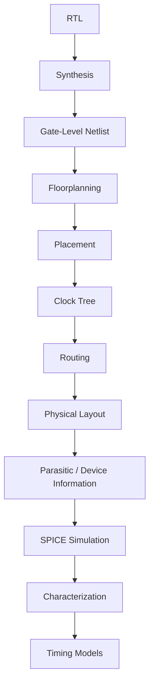
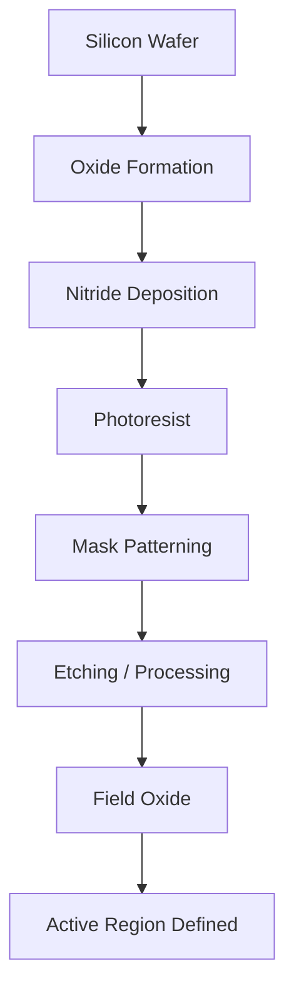
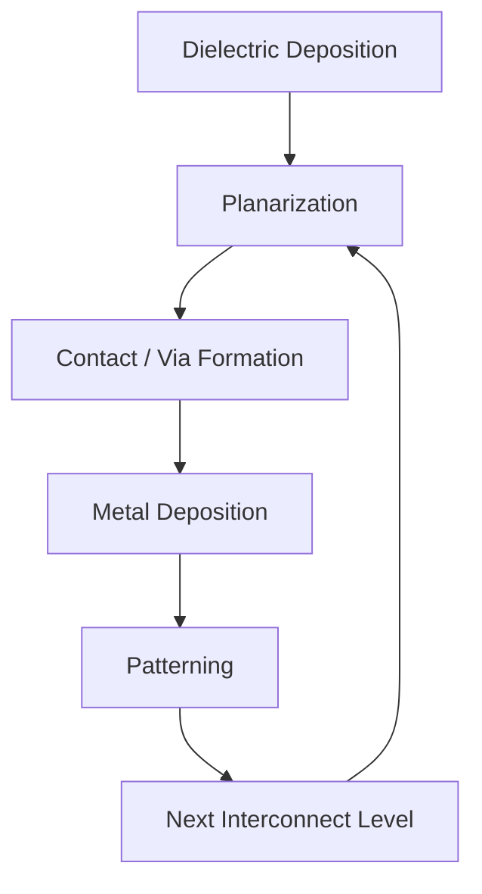
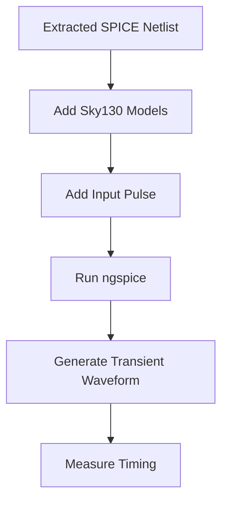
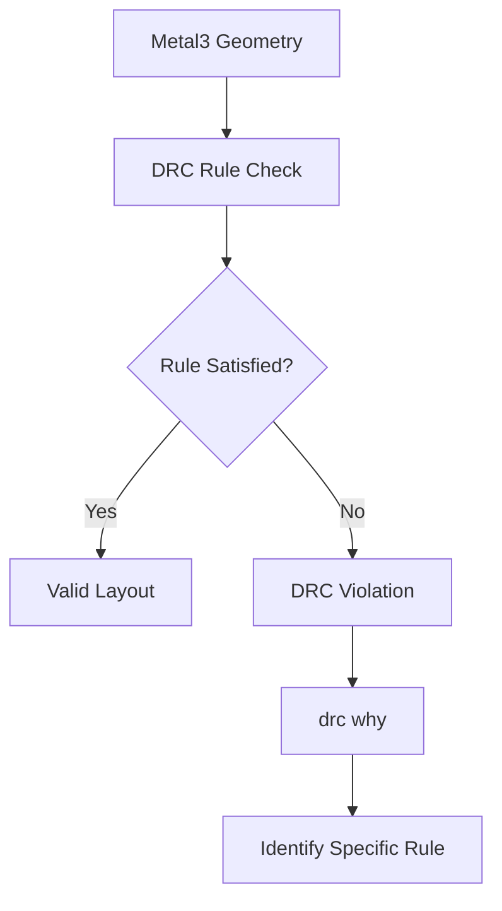
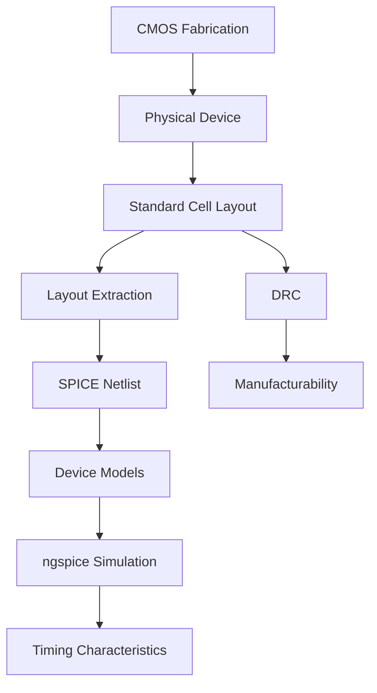
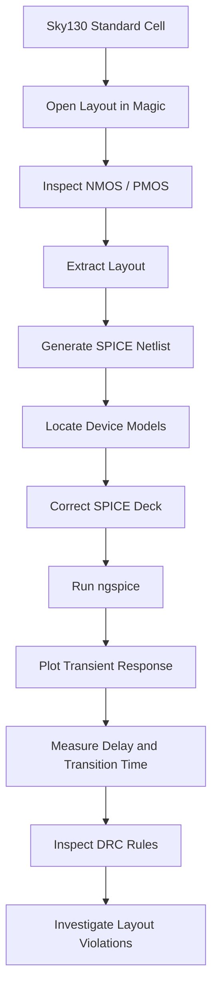

# PHYSICAL-DESIGN-DAY3


# Day 3 — CMOS Characterization, Fabrication and Layout Analysis

## Overview

This module moves from the physical-design stages studied earlier into the transistor and device level of an ASIC.

At this stage, the focus is no longer only on where standard cells are placed. The objective is to understand what is actually inside a CMOS standard cell, how its electrical behavior can be characterized, how the transistor structure is fabricated, and how a physical layout can be converted back into an electrical simulation model.

The work in this module covers four connected areas:

1. SPICE-based characterization of a CMOS inverter
2. The 16-mask CMOS fabrication process
3. Extraction of a Sky130 standard-cell layout into a SPICE netlist
4. DRC investigation using Magic

The practical work uses the Sky130 technology, Magic, ngspice and the `sky130_inv` standard-cell layout.

---

# 1. Learning Objectives

The main objectives of this module are to:

* Understand the basic structure of a SPICE netlist.
* Understand how a CMOS inverter behaves electrically.
* Study the DC transfer characteristic of an inverter.
* Understand the inverter switching threshold, \(V_M\).
* Understand rise time and fall time.
* Understand propagation delay.
* Study the major stages of CMOS fabrication.
* Understand how the 16-mask process builds a CMOS structure.
* Open and inspect a Sky130 standard-cell layout in Magic.
* Identify NMOS and PMOS regions in a physical layout.
* Extract a SPICE netlist from a layout.
* Understand why an extracted netlist may require model corrections.
* Locate the Sky130 transistor models used for simulation.
* Run the extracted inverter using ngspice.
* Measure transition time and cell delay.
* Understand the purpose of design-rule checking.
* Investigate actual DRC violations using Magic.

---

# 2. Position in the ASIC Design Flow

The previous physical-design stages work mainly with the synthesized digital design.

This module goes one level deeper.

The overall relationship can be represented as:



This creates an important connection between digital implementation and transistor-level behavior.

A standard cell may look like a simple logic gate at the RTL level, but physically it consists of transistors, interconnect, contacts and multiple material layers.

---

# 3. SPICE Netlist Basics

SPICE is used to simulate the electrical behavior of circuits.

A SPICE description needs three basic types of information:

* Connectivity
* Component parameters
* Device models

For a transistor-level circuit, the connectivity specifies which nodes are connected to the transistor terminals.

The component parameters describe physical or electrical properties such as:

* Width
* Length
* Capacitance
* Voltage
* Resistance

The device model provides the electrical equations and parameters used by the simulator to represent the transistor.

A simplified CMOS inverter contains:

```text
             VDD
              |
             PMOS
              |
Input --------+-------- Output
              |
             NMOS
              |
             GND
```

When the input is low, the PMOS pulls the output toward VDD.

When the input is high, the NMOS pulls the output toward ground.

This simple structure is the basis for understanding the electrical characterization performed later.

---

# 4. Important SPICE Analysis Types

Several types of analysis can be performed using SPICE.

## Operating Point Analysis

The `.op` command determines the steady-state operating point of the circuit.

It is useful for examining quantities such as:

* Node voltages
* Device currents
* Bias conditions

---

## DC Sweep

A `.dc` analysis varies an input or supply voltage over a specified range.

For a CMOS inverter, sweeping the input voltage allows us to generate the voltage-transfer characteristic.

Conceptually:

```text
Vin
 |
 |        ______
 |       /
 |      /
 |     /
 |____/
 +------------------> Vout
```

The actual inverter characteristic is an S-shaped transition from a high output to a low output.

---

## Transient Analysis

The `.tran` command is used to observe how the circuit changes with time.

Instead of slowly sweeping the input, a pulse waveform can be applied.


This is the analysis used later to measure rise time, fall time and propagation delay.

---

# 5. CMOS Inverter Switching Threshold

One of the important static characteristics of an inverter is the switching threshold, commonly represented as \(V_M\).

It is approximately the point on the voltage-transfer curve where:

$$
V_{in}=V_{out}
$$

At this point, both the NMOS and PMOS contribute significantly to the circuit behavior.

The switching point depends on the relative strength of the two transistors.

A simplified relationship is:

$$
\frac{W_n}{L_n}
$$

compared with

$$
\frac{W_p}{L_p}
$$

The PMOS is generally made wider than the NMOS because hole mobility is lower than electron mobility.

Increasing the PMOS width changes the balance between the pull-up and pull-down networks and can therefore shift the switching threshold.

---

# 6. CMOS Inverter Transfer Characteristic

When the input voltage is gradually increased from 0 to VDD, the inverter passes through different operating regions.

A simplified sequence is:

```text
Vin increases
     |
     v
PMOS strongly conducting
NMOS mostly OFF
     |
     v
Both devices begin conducting
     |
     v
Transition region
     |
     v
NMOS becomes dominant
     |
     v
PMOS approaches OFF
     |
     v
Output approaches GND
```

The important point is that the inverter does not switch instantaneously.

There is a region in which both devices contribute to the output transition.

---

# 7. Dynamic CMOS Behavior

Static behavior tells us where the inverter switches.

Dynamic behavior tells us **how quickly it switches**.

This is important because a digital circuit does not operate with ideal instantaneous transitions.

A real signal has:

* Rising transition
* Falling transition
* Propagation delay
* Finite slope

A transient SPICE simulation allows these quantities to be measured.

---

# 8. Rise Time and Fall Time

Transition time describes how quickly the output changes between two voltage levels.


Slow transitions can increase switching power and can also affect the behavior of subsequent logic stages.

---

# 9. Propagation Delay

Propagation delay measures the time between a change at the input and the corresponding response at the output.


---

# 10. CMOS Fabrication

The electrical behavior of a CMOS inverter is determined by the physical structure of its transistors.

That structure is created through a sequence of fabrication steps involving:

* Oxidation
* Deposition
* Photolithography
* Etching
* Ion implantation
* Diffusion
* Annealing
* Metal deposition
* Planarization

Masks are used to define where different materials and dopants are introduced.

The fabrication sequence therefore transforms a silicon wafer into a complete transistor and interconnect structure.

---

# 11. Starting Substrate

The process begins with a silicon wafer.

The substrate provides the material in which the transistor regions will eventually be formed.

The crystal orientation and doping characteristics of the wafer affect the electrical behavior and fabrication process.

At this point, there are no completed CMOS transistors.

The subsequent process steps gradually create:

```text
Substrate
   ↓
Wells
   ↓
Active Regions
   ↓
Gate
   ↓
Source / Drain
   ↓
Contacts
   ↓
Metal Interconnect
   ↓
Completed CMOS Structure
```

---

# 12. Active Region Formation

The active region determines where transistor formation is allowed.

A simplified fabrication sequence is:



The source material discusses the use of LOCOS for field-oxide formation.

One characteristic of LOCOS is the lateral extension of oxide beneath the masking structure, commonly called the **bird's-beak effect**.

This is an important example of how fabrication techniques introduce physical effects that have to be considered in semiconductor manufacturing.

---

# 13. N-Well and P-Well Formation

CMOS requires both NMOS and PMOS devices.

The two transistor types require different substrate environments.

Therefore, well formation creates the required regions for the two devices.

A simplified structure is:

```text
             CMOS Structure

        N-Well             P-Well
     +-----------+       +-----------+
     |   PMOS    |       |   NMOS    |
     |           |       |           |
     +-----------+       +-----------+
```

Ion implantation introduces the required dopants.

A later thermal process activates the dopants and allows them to occupy the required depth within the silicon.

---

# 14. Gate Formation

The gate controls the conduction of the MOS transistor.

The gate structure consists of a thin insulating oxide and a conductive gate material.

A simplified cross-section is:

```text
        Gate
     +---------+
     |   Poly  |
     +---------+
     | Oxide   |
-----+---------+-----
     Silicon
```

The gate is particularly important because its voltage controls the formation of the conductive channel between source and drain.

The gate dimensions also have a strong influence on transistor performance.

---

# 15. LDD Formation

Lightly Doped Drain structures are used to reduce electric-field-related effects near the drain.

A simplified structure is:

```text
Source       Gate        Drain
  |           |            |
  v           v            v

 N+       N-     N-       N+
          |      |
          +------+
           Channel
```

The lightly doped regions reduce the abruptness of the transition between the channel and heavily doped source/drain regions.

This is particularly important for controlling effects that become more significant as transistor dimensions decrease.

---

# 16. Source and Drain Formation

After the gate and lightly doped regions have been established, the heavily doped source and drain regions are formed.

The source and drain provide the terminals through which current flows into and out of the transistor.

A simplified NMOS structure is:

```text
        Gate
         |
         v
    +---------+
    |   Poly  |
----+---------+----
 N+ | Channel | N+
    |         |
    +---------+
   Source     Drain
```

The PMOS structure follows the complementary doping arrangement.

Thermal processing is then used to activate the implanted dopants and repair implantation-related damage.

---

# 17. Contacts and Local Interconnect

Once the transistor structures are formed, electrical connections need to be established.

Contacts connect the transistor terminals to the interconnect system.

The fabrication process introduces contact materials and local interconnect structures before the higher-level metal layers are formed.

This creates the transition:

```text
Transistor
    |
    v
Contact
    |
    v
Local Interconnect
    |
    v
Metal Layer
```

Without these connections, the individual transistor terminals could not be connected together to form logic circuits.

---

# 18. Metal Interconnect

Modern digital circuits contain many levels of metal interconnect.

These layers connect cells and devices across the chip.

The general sequence involves:



The process is repeated as additional metal layers are built.

A final passivation layer protects the completed structure.

The final openings provide access to the required bonding regions.

---

# 19. The 16-Mask Process

The fabrication sequence discussed in this module can be viewed as a progression from the substrate to the completed interconnect stack.

```text
Silicon Wafer
      |
      v
Active Region Definition
      |
      v
Well Formation
      |
      v
Gate Preparation
      |
      v
Gate Formation
      |
      v
LDD Formation
      |
      v
Source / Drain
      |
      v
Contacts
      |
      v
Metal 1
      |
      v
Additional Metal Levels
      |
      v
Passivation
      |
      v
Bond Pad Opening
      |
      v
Completed CMOS Structure
```

The exact mask-to-process correspondence is technology dependent, but the important concept is that every physical feature in the final device is created through a controlled sequence of masking and processing steps.

---

# 20. Sky130 Standard-Cell Layout

The theoretical fabrication process becomes easier to understand when it is connected to an actual standard-cell layout.

The `sky130_inv` cell represents a CMOS inverter implemented using the Sky130 technology.

The layout contains:

* PMOS region
* NMOS region
* Polysilicon
* Metal
* Contacts
* Power rails
* Input connection
* Output connection

A simplified logical view is:

```text
              VPWR
                |
               PMOS
                |
A --------------+-------------- Y
                |
               NMOS
                |
              VGND
```

The layout is the physical representation of this electrical circuit.

---

# 21. Opening the Layout in Magic

The Sky130 inverter layout can be opened using Magic with the appropriate technology file.

Example:

```bash
magic -T sky130A.tech sky130_inv.mag &
```

The technology file tells Magic how to interpret the layers used by the layout.

Once opened, the physical geometry can be inspected at different zoom levels.

The important layers include:

* Diffusion
* Polysilicon
* Metal
* Contacts
* Wells

---

# 22. Identifying NMOS and PMOS

Magic provides commands that can be used to inspect the layer under the cursor.

The `what` command can be used to identify the selected region.

Conceptually:

```text
Select Region
      |
      v
    what
      |
      v
Identify Layer / Device
      |
      v
Determine NMOS or PMOS
```

This provides a useful connection between the physical geometry and the transistor-level circuit.

The two devices may look similar at first glance, but their well and diffusion structures distinguish the NMOS and PMOS regions.

---

# 23. Extracting the SPICE Netlist

One of the most useful parts of the exercise is extracting a SPICE representation directly from the physical layout.

The basic Magic commands are:

```tcl
extract all
ext2spice cthresh 0
ext2spice
```

The process is:


This is important because it demonstrates that a physical layout can be converted back into an electrical representation.

The extracted netlist includes information derived from the actual geometry.

---

# 24. Why the Extracted Netlist Needs Modification

The first extracted SPICE file is not necessarily ready for simulation.

Magic generates device references based on the information available to it during extraction.

The extracted netlist may therefore need to be connected to the appropriate Sky130 device models.

This is where the model-library files become important.

The required models provide the transistor characteristics that ngspice uses during simulation.

---

# 25. Sky130 Device Models

The standard-cell design environment contains transistor model information for simulation.

The important files used in this exercise include:

```text
pshort.lib
nshort.lib
```

These libraries contain the required PMOS and NMOS device models.

The relevant model names identified during the exercise are:

```text
pshort_model.0
nshort_model.0
```

These models allow ngspice to represent the electrical characteristics of the corresponding devices.

The relationship is:

```text
Physical Layout
      |
      v
Extracted Transistors
      |
      v
Sky130 Device Models
      |
      v
SPICE Simulation
```

---

# 26. Preparing the SPICE Deck

The extracted netlist needs the required model libraries, circuit definition and simulation commands.

A simplified SPICE structure is:

```spice
.include ./libs/pshort.lib
.include ./libs/nshort.lib

.subckt sky130_inv A Y VPWR VGND

* Transistor definitions

.ends sky130_inv

* Input stimulus

* Transient analysis

.tran ...
```

The exact transistor parameters and extracted parasitic elements come from the layout.

The important point is that the SPICE deck combines:

* Extracted physical information
* Device models
* Power supplies
* Input stimulus
* Simulation commands

---

# 27. Running the Simulation

The simulation is performed using ngspice.

A successful simulation produces transient voltage data that can be plotted and analyzed.

The basic flow is:



The first simulation attempt exposed an important practical issue: the extracted netlist did not initially reference the required model definitions correctly.

After correcting the model includes and transistor references, the transient simulation could be executed successfully.

This is a useful example of why generated EDA files often need to be checked rather than assumed to be immediately usable.

---

# 28. Transient Waveform

The CMOS inverter was driven with a pulse input and its output was observed over time.

The resulting waveform contains repeated transitions between the logic-high and logic-low levels.

Conceptually:

```text
Input

HIGH  ────────┐       ┌────────
              │       │
LOW           └───────┘


Output

HIGH  ────────┘       └────────
              │       │
LOW           └───────┘
```

The output is inverted relative to the input.

The transition does not occur instantaneously because the transistor and interconnect have finite electrical characteristics.

---

# 29. Measured Timing Results

The transient simulation produced the following measurements:

| Parameter            | Measurement             |     Result |
| -------------------- | ----------------------- | ---------: |
| Rise transition time | 20% to 80%              | 0.06194 ns |
| Fall transition time | 80% to 20%              | 0.04267 ns |
| Cell rise delay      | 50% input to 50% output | 0.05953 ns |
| Cell fall delay      | 50% input to 50% output | 0.05941 ns |

These measurements provide practical examples of the timing definitions discussed earlier.

The transition times describe the slope of the output edge, while the cell rise and fall delays describe the time shift between the input and output transitions.

---

# 30. Interpreting the Results

The rise and fall transition times are not identical.

This is expected because PMOS and NMOS transistors do not have identical carrier mobility or electrical strength.

Similarly, the propagation delays for rising and falling transitions can differ depending on:

* Transistor sizing
* Load capacitance
* Device characteristics
* Parasitic capacitance
* Input transition
* Operating conditions

The measured values therefore represent the behavior of this particular extracted inverter under the simulation conditions used.

They should not be treated as universal values for every Sky130 inverter.

---

# 31. From Layout to Timing

This experiment demonstrates an important relationship in physical design:


This is one of the most important connections in the module.

The physical dimensions of a cell influence its electrical behavior, and that electrical behavior eventually affects digital timing.

---

# 32. Design Rule Checking

A layout must follow a set of manufacturing rules.

These rules define restrictions such as:

* Minimum width
* Minimum spacing
* Minimum area
* Contact dimensions
* Via dimensions
* Layer relationships

The purpose of DRC is to identify geometries that may not be manufacturable according to the technology rules.

A simplified flow is:

```text
Layout
  |
  v
DRC Rule Deck
  |
  v
Geometry Checks
  |
  +---- Width
  +---- Spacing
  +---- Area
  +---- Enclosure
  |
  v
DRC Report
```

---

# 33. Investigating DRC Violations

Magic provides the `drc why` command to investigate the reason for a reported violation.

Instead of simply knowing that a layout contains an error, the command can provide information about the specific rule that was violated.

For example, the investigated Metal3 rules included:

```text
Metal3 spacing < 0.3 µm
```

and:

```text
Metal3 minimum area < 0.24 µm²
```

These rules illustrate why geometric dimensions are important in physical layout.

A shape can be electrically correct from a circuit-design perspective but still violate manufacturing constraints.

---

# 34. Metal3 Investigation

The DRC test structures contained several Metal3 examples.

The purpose was to compare geometries that satisfy the design rules with geometries that violate them.

The investigation showed that DRC is essentially a geometric verification process.

The tool compares the physical layout against the rules defined by the technology.



---

# 35. Via and Contact Inspection

The layout can also be inspected at a more detailed level.

Commands such as:

```tcl
paint m3contact
```

and:

```tcl
cif see VIA2
```

can be used to inspect particular physical layers.

A selected via structure was measured at approximately:

```text
Width  = 0.190 µm
Height = 0.200 µm
Area   = 0.038 µm²
```

This demonstrates how Magic can be used not only to view a layout but also to inspect individual geometrical features.

---

# 36. Poly Layer Investigation

The same approach can be applied to the polysilicon layer.

A selected poly region in the reference structure was measured at approximately:

```text
Width  = 0.335 µm
Height = 0.210 µm
Area   ≈ 0.070 µm²
```

The region was associated with the relevant poly design rule in the test structure.

This demonstrates the importance of checking individual layers when debugging physical-layout violations.

---

# 37. Connecting Fabrication, Layout and Simulation

The most useful part of this module is the connection between concepts that are often studied separately.

The complete relationship can be represented as:



This gives a much clearer picture of the complete process.

Fabrication determines the physical structures.

The layout represents those structures geometrically.

Extraction converts the geometry into an electrical representation.

SPICE uses transistor models and extracted information to simulate behavior.

DRC checks whether the physical geometry follows manufacturing rules.

---

# 38. Important Practical Lessons

### 1. A layout is more than a drawing

Every shape in a layout represents a physical layer or connection.

Its dimensions and position can have electrical and manufacturing consequences.

### 2. Extraction connects physical design to circuit simulation

A layout can be converted into a SPICE representation, allowing the electrical behavior of the physical implementation to be analyzed.

### 3. Device models are essential

The simulator needs appropriate transistor models to reproduce the electrical behavior of the technology.

### 4. Generated files should always be inspected

EDA tools can generate intermediate files automatically, but those files may still need configuration or modification before they can be used for the intended analysis.

### 5. Timing comes from physical behavior

Cell delay is influenced by transistor characteristics, load and parasitic effects.

### 6. DRC is a manufacturing check

A circuit can be logically correct but physically invalid.

DRC helps identify geometries that violate the manufacturing rules.

---

# 39. Practical Workflow

The complete hands-on process can be summarized as:



---

# 40. Tools Used

| Tool / Technology | Purpose                                          |
| ----------------- | ------------------------------------------------ |
| SKY130 PDK        | Semiconductor technology information             |
| Magic             | Layout viewing, extraction and DRC investigation |
| ngspice           | Transistor-level circuit simulation              |
| OpenLane          | ASIC implementation environment                  |
| OpenROAD          | Physical-design infrastructure                   |
| SPICE             | Circuit representation and simulation            |
| BSIM4 Models      | Transistor electrical models                     |

---

# 41. Important Files and Commands

Some of the important files and commands used during the practical work are:

| Item               | Purpose                            |
| ------------------ | ---------------------------------- |
| `sky130_inv.mag`   | Physical inverter layout           |
| `sky130_inv.ext`   | Extracted layout information       |
| `sky130_inv.spice` | SPICE representation               |
| `pshort.lib`       | PMOS device model library          |
| `nshort.lib`       | NMOS device model library          |
| `sky130A.tech`     | Magic technology definition        |
| `extract all`      | Extract layout information         |
| `ext2spice`        | Convert extraction to SPICE        |
| `what`             | Identify the selected layer/device |
| `drc why`          | Investigate a DRC violation        |
| `cif see VIA2`     | Display the selected CIF layer     |

---

# 42. Summary of the Module

This module connects three different levels of semiconductor design.

At the **device level**, the behavior of PMOS and NMOS transistors determines how a CMOS inverter switches.

At the **layout level**, those transistors are represented using physical layers such as diffusion, polysilicon, contacts and metal.

At the **simulation level**, the layout can be extracted into a SPICE netlist and combined with Sky130 device models to reproduce the electrical behavior of the physical cell.

The fabrication section adds another layer of understanding by showing how these physical structures are actually created on silicon through a sequence of lithography, implantation, deposition, etching and planarization steps.

Finally, DRC demonstrates that physical layout has to satisfy manufacturing constraints in addition to being logically correct.

---

# 43. Key Takeaways

The major concepts covered in this module are:

1. SPICE provides a way to simulate transistor-level circuits.
2. A SPICE deck requires connectivity, device parameters and appropriate models.
3. A CMOS inverter has both static and dynamic characteristics.
4. The switching threshold \(V_M\) describes the approximate transition point of the inverter.
5. Rise and fall transition times describe the speed of output voltage changes.
6. Propagation delay measures the timing relationship between input and output transitions.
7. CMOS fabrication uses multiple masks to define different physical structures.
8. Well formation allows NMOS and PMOS devices to coexist on the same chip.
9. The gate controls the transistor channel.
10. LDD structures help manage electric-field effects.
11. Source and drain regions provide the main current paths.
12. Contacts and metal layers connect devices into complete circuits.
13. Magic can be used to inspect and extract a physical layout.
14. Extracted layouts can be converted into SPICE netlists.
15. Device models are required for meaningful transistor simulation.
16. ngspice can be used to measure dynamic behavior.
17. Physical geometry contributes to electrical delay through parasitic effects.
18. DRC verifies whether layout geometry satisfies manufacturing rules.
19. `drc why` helps identify the specific reason for a reported violation.
20. Physical design connects circuit logic, device physics, layout geometry and manufacturing constraints.

---

# 44. Final Conclusion

The main purpose of this module is to understand what happens below the standard-cell level.

Earlier physical-design stages deal mainly with the organization of cells and the overall chip structure. This module goes deeper into the transistor, layout and fabrication level.

The CMOS inverter provides a useful example because it is simple enough to understand while still containing the major elements of a real standard cell.


At the same time, the fabrication and DRC sections show why the physical dimensions of the layout matter.

A design must not only perform the required logical function. Its physical implementation must also satisfy electrical, timing and manufacturing constraints.

This provides the foundation for understanding standard-cell characterization, timing libraries and the deeper relationship between physical design and transistor-level behavior.

---


