# MODULE-1-2
RTL design, simulation and logic synthesis using Icarus Verilog, GTKWave and Yosys with the Sky130 standard-cell library.
# RTL Design, Simulation and Synthesis: Modules 1 and 2


## Table of Contents
- [Module 1: RTL Design, Simulation and Yosys Basics](#module-1-rtl-design-simulation-and-yosys-basics)
- [Module 2: Timing Libraries, Hierarchical vs Flat Synthesis and Flip-Flop Coding](#module-2-timing-libraries-hierarchical-vs-flat-synthesis-and-flip-flop-coding)
- [Overall Summary](#overall-summary)

---

# Module 1: RTL Design, Simulation and Yosys Basics

## 1.1 Introduction to RTL Design and Simulation

| Term | Meaning |
|---|---|
| **Design (DUT)** | The hardware logic that implements the required functionality |
| **Simulation** | Testing the behaviour of the design in software before hardware implementation |
| **Test Bench** | A verification environment that generates inputs (stimulus) and observes the outputs of the DUT |

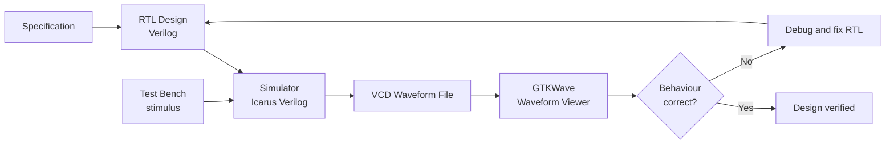

### Testbench and DUT relationship

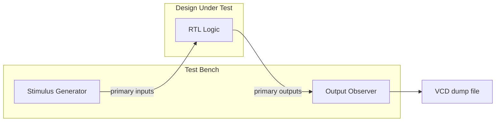

---

## 1.2 Environment Setup

| Tool | Role |
|---|---|
| **Git** | Cloned the `sky130RTLDesignAndSynthesisWorkshop` repository (RTL examples, libraries, exercises) |
| **Icarus Verilog (`iverilog`)** | Open-source Verilog compiler and simulator |
| **GTKWave** | Waveform viewer for VCD files |
| **GVim / Neovim** | Text editor for Verilog source files |
| **Yosys** | Open-source RTL synthesis framework |

```bash
sudo apt install iverilog
sudo apt install gtkwave
sudo apt install neovim-qt
```

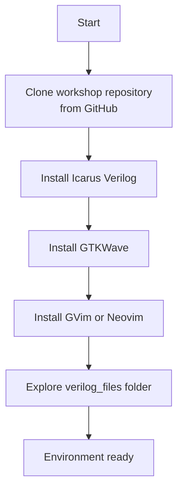

---

## 1.3 Lab 2: Icarus Verilog, GTKWave and GVim

**Files:** `good_mux.v` (2:1 multiplexer) and `tb_good_mux.v` (test bench)

### Design

```verilog
module good_mux (input i0, input i1, input sel, output reg y);
always @(*)
begin
    if(sel)
        y <= i1;
    else
        y <= i0;
end
endmodule
```

> **Note:** The recommended style for combinational logic is blocking assignment (`=`). The `<=` was used in the workshop file as given.

### Test bench highlights

```verilog
good_mux uut (.sel(sel), .i0(i0), .i1(i1), .y(y));

$dumpfile("tb_good_mux.vcd");
$dumpvars(0, tb_good_mux);

always #75 sel = ~sel;
always #10 i0  = ~i0;
always #55 i1  = ~i1;
```

### Simulation commands

```bash
iverilog good_mux.v tb_good_mux.v
./a.out
gtkwave tb_good_mux.vcd
```

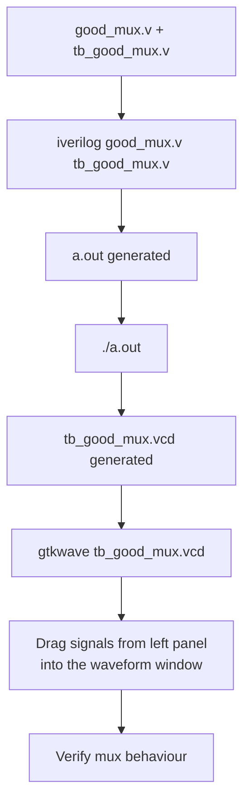

### 2:1 Multiplexer logic

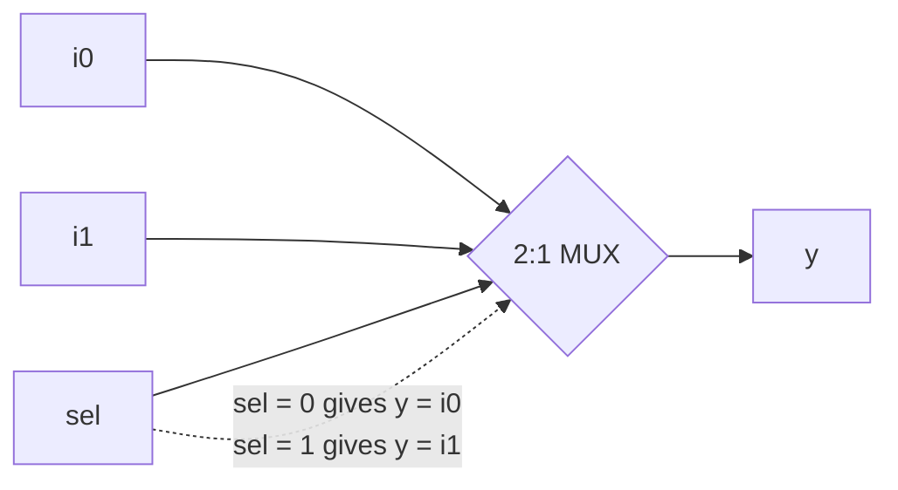

---

## 1.4 Introduction to Yosys and Logic Synthesis

**Yosys** is an open-source RTL synthesis framework. It reads Verilog RTL, optimizes it, and maps it to cells from a technology library to produce a gate-level netlist.

| Command | Purpose |
|---|---|
| `read_verilog` | Reads the RTL design |
| `read_liberty` | Reads the standard-cell library |
| `write_verilog` | Writes the synthesized netlist |

### What is logic synthesis?

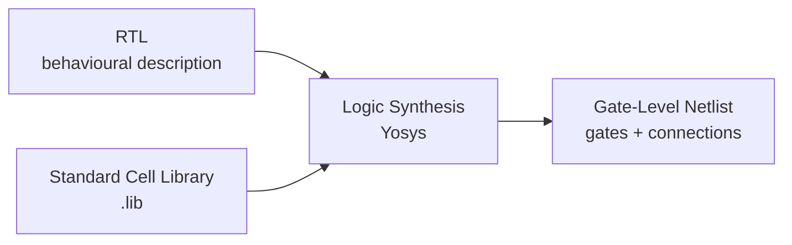

### Why different cell flavours?

Digital circuits have capacitive loads that must be charged and discharged.

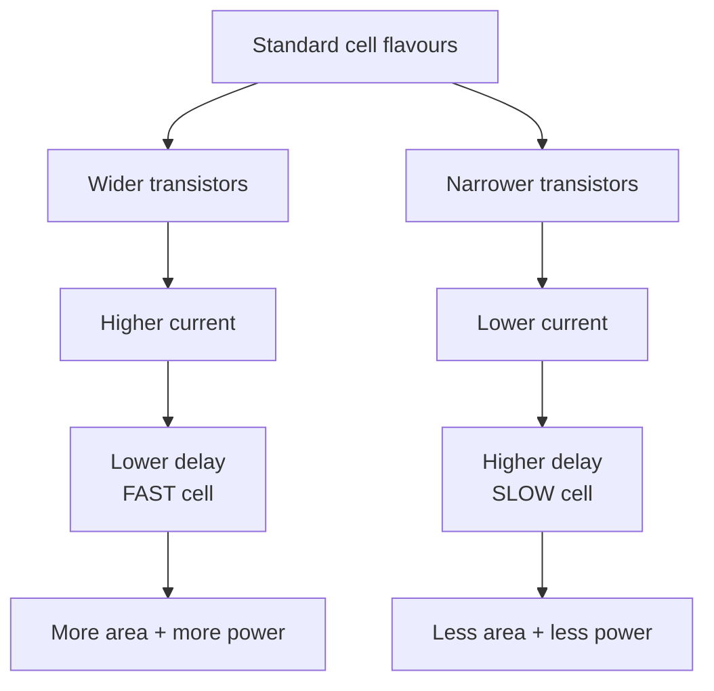

### Timing constraint

```
Tclk > Tcq + Tcombi + Tsetup
```

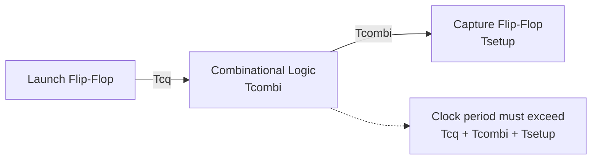

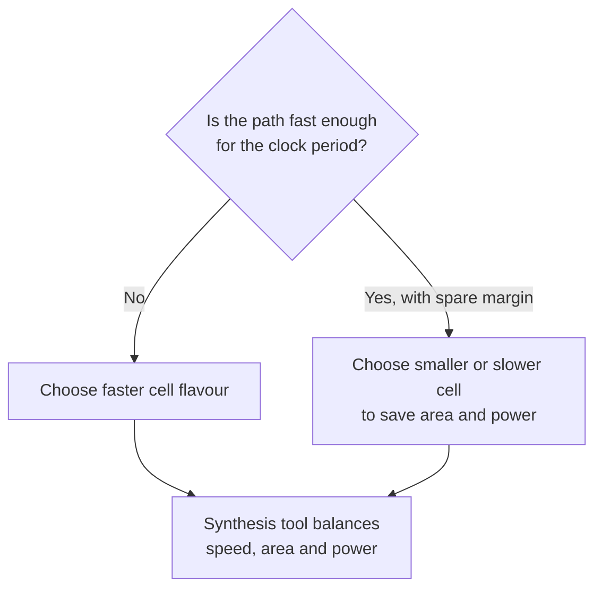

### Verifying the synthesized netlist

The same test bench is reused because the primary inputs and outputs do not change.

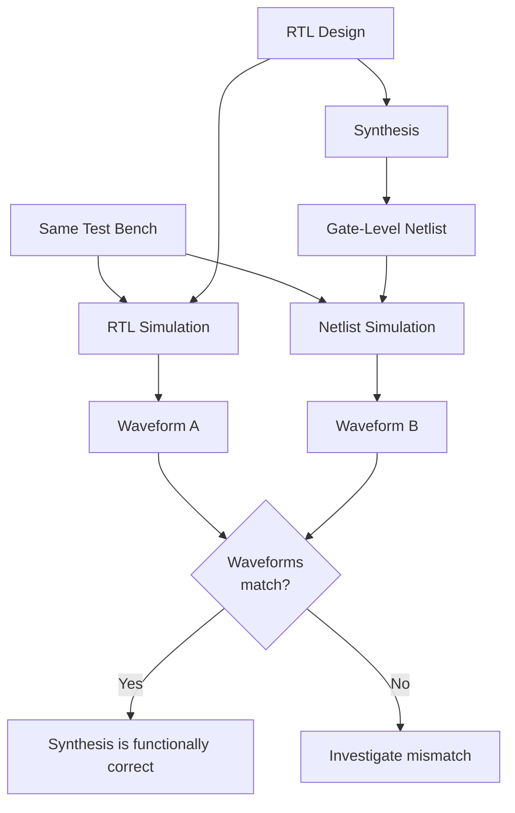

---

## 1.5 Lab 3: Invoke Yosys and Synthesize `good_mux`

### Commands (in order)

```
yosys
read_liberty -lib ../lib/sky130_fd_sc_hd__tt_025C_1v80.lib
read_verilog good_mux.v
synth -top good_mux
abc -liberty ../lib/sky130_fd_sc_hd__tt_025C_1v80.lib
show
write_verilog good_mux_netlist.v
```

| Step | Command | What it does |
|---|---|---|
| 1 | `read_liberty -lib` | Loads the Sky130 cell library |
| 2 | `read_verilog` | Reads the RTL of the multiplexer |
| 3 | `synth -top good_mux` | Runs RTL synthesis with `good_mux` as top module |
| 4 | `abc -liberty` | Optimizes logic and maps it to Sky130 standard cells |
| 5 | `show` | Displays the synthesized circuit graphically |
| 6 | `write_verilog` | Writes the gate-level netlist file |

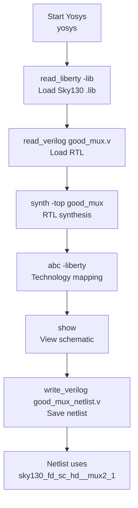

### RTL to gate-level mapping

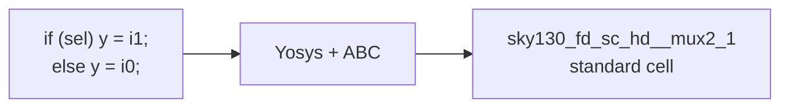

---

## Module 1 Learning Outcomes
- Understood the difference between Design, Simulation and Test Bench.
- Set up and verified Icarus Verilog, GTKWave and GVim.
- Compiled and simulated `good_mux`, and viewed its VCD waveforms.
- Understood RTL, logic synthesis, `.lib` files and cell flavours.
- Learned the speed, area and power trade-off and the timing constraint.
- Invoked Yosys, synthesized `good_mux` and generated a gate-level netlist.
- Understood how a netlist is verified with the same test bench.

---

# Module 2: Timing Libraries, Hierarchical vs Flat Synthesis and Flip-Flop Coding

## 2.1 Sky130 Standard Cell Library Walkthrough

The `.lib` file was opened in GVim to understand how cells are characterized.

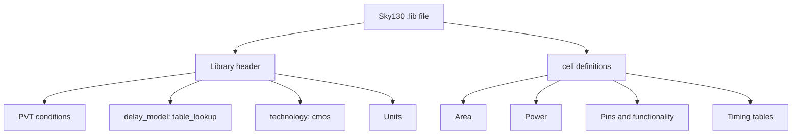

### PVT: Process, Voltage, Temperature

| Parameter | Value in library | Meaning |
|---|---|---|
| **Process** | Typical (tt) | Manufacturing variation |
| **Voltage** | 1.80 V | Supply voltage |
| **Temperature** | 25 °C | Operating temperature |

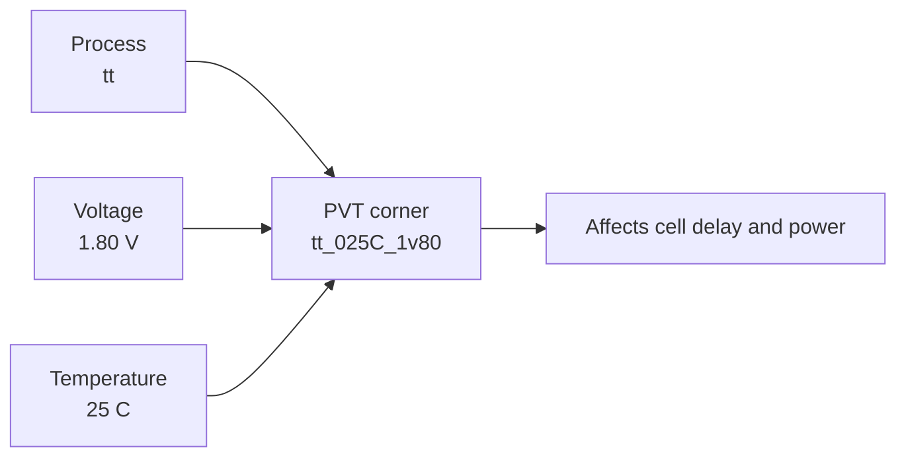

### Library settings

| Item | Value |
|---|---|
| Delay model | `table_lookup` (indexed by input transition and output load) |
| Technology | `cmos` |
| Time | ns |
| Voltage | V |
| Current | mA |
| Resistance | kohm |
| Capacitance | pF |
| Leakage power | nW (per the `.lib` header) |

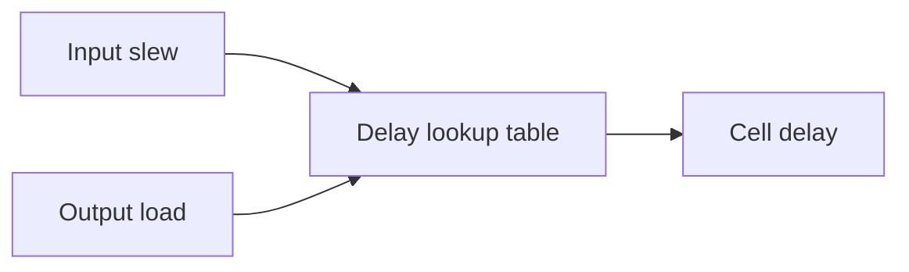

### Different flavours of the same gate

| AND gate | Area | Drive strength |
|---|---|---|
| `sky130_fd_sc_hd__and2_0` | 6.25 | Lower |
| `sky130_fd_sc_hd__and2_2` | 7.50 | Medium |
| `sky130_fd_sc_hd__and2_4` | 8.75 | Higher |

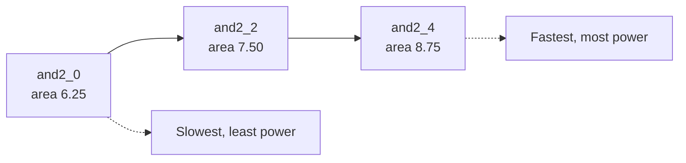

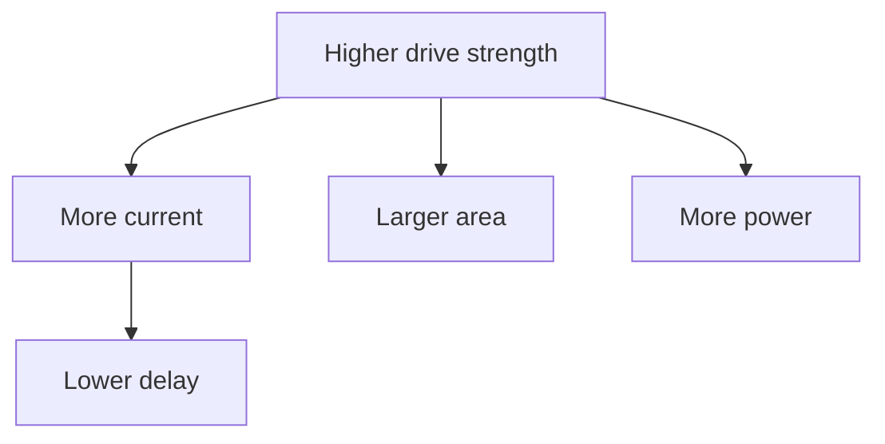

---

## 2.2 Hierarchical vs Flat Synthesis

### Design used: `multiple_modules.v`

```verilog
module sub_module1(input a, input b, output y);
    assign y = a & b;
endmodule

module sub_module2(input a, input b, output y);
    assign y = a | b;
endmodule

module multiple_modules(input a, input b, input c, output y);
    wire net1;
    sub_module1 u1 (.a(a), .b(b), .y(net1));
    sub_module2 u2 (.a(net1), .b(c), .y(y));
endmodule
```

Function implemented: **y = (a & b) | c**

### Design structure

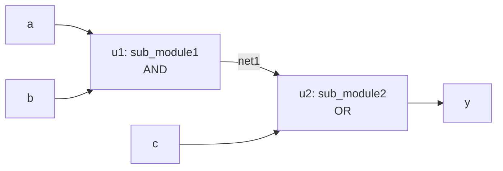

### Reading the design into Yosys

```
yosys
read_liberty -lib ../lib/sky130_fd_sc_hd__tt_025C_1v80.lib
read_verilog multiple_modules.v
```

### Flow comparison

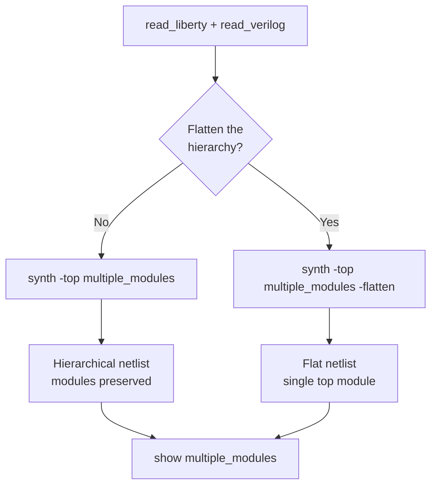

### Hierarchical netlist

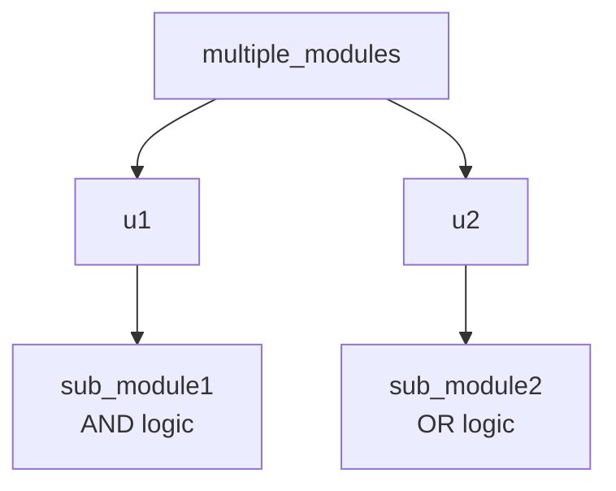

### Flat netlist

```mermaid
flowchart TD
    TOP["multiple_modules"] --> AND["AND cell"]
    TOP --> OR["OR cell"]
```

### Side-by-side comparison

| Feature | Hierarchical | Flat |
|---|---|---|
| Command | `synth -top multiple_modules` | `synth -top multiple_modules -flatten` |
| Module boundaries | Preserved | Removed |
| Optimization across modules | Limited | Greater freedom |
| Netlist size | Easier to read | Can become large |
| Debugging | Easier | Harder |
| Best for | Large SoCs, reusable IP, repeated modules, block-level design | Small designs needing maximum optimization |
| Logic function | y = (a & b) \| c | y = (a & b) \| c |

```mermaid
flowchart TD
    Q{"Which approach?"} --> A{"Large design with<br/>reusable IP or blocks?"}
    A -- "Yes" --> H["Hierarchical synthesis"]
    A -- "No" --> B{"Need maximum<br/>cross-module optimization?"}
    B -- "Yes" --> F["Flat synthesis"]
    B -- "No" --> H
    H --> H1["Easier debug and management"]
    F --> F1["More optimization freedom"]
```

> Both approaches implement the **same logic function**. Only the structure of the netlist differs.

---

## 2.3 Why Flip-Flops and Flop Coding Styles

### Why use flip-flops?
- Store the state of a circuit
- Synchronize data with the clock
- Break long combinational paths into smaller timing stages
- Build registers, counters, state machines and pipelines

### What is a glitch?
A short, unwanted output change in a combinational circuit, caused by different propagation delays through different paths.

```mermaid
flowchart TD
    A["Multiple inputs change<br/>at nearly the same time"] --> B["Signals reach gates<br/>at different times"]
    B --> C["Output briefly takes<br/>incorrect value"]
    C --> D["Glitch"]
    D --> E["Flip-flop samples only<br/>at clock edge"]
    E --> F["Glitch not stored as state"]
```

### Flip-flop operation

```mermaid
flowchart LR
    D["D input"] --> FF["Flip-Flop"]
    CLK["Clock edge"] --> FF
    FF --> Q["Q output<br/>holds value until<br/>next active edge"]
```

### Asynchronous reset

```verilog
always @(posedge clk or posedge async_reset)
begin
    if (async_reset)
        q <= 1'b0;
    else
        q <= d;
end
```

### Synchronous reset

```verilog
always @(posedge clk)
begin
    if (sync_reset)
        q <= 1'b0;
    else
        q <= d;
end
```

```mermaid
flowchart TD
    A{"Reset type?"} -- "Asynchronous" --> B["Sensitivity list:<br/>posedge clk or posedge reset"]
    A -- "Synchronous" --> C["Sensitivity list:<br/>posedge clk only"]
    B --> D["Output reset immediately,<br/>independent of clock"]
    C --> E["Reset checked<br/>only at clock edge"]
```

| Feature | Asynchronous Reset | Synchronous Reset |
|---|---|---|
| Clock dependency | Independent of clock | Depends on clock |
| Reset response | Immediate | At clock edge |
| Sensitivity list | Clock + reset | Clock only |
| Main advantage | Immediate initialization | Controlled timing |

### Mixed reset
Reset is **asserted asynchronously** (known state immediately) and **released synchronously** (controlled release with the clock).

```mermaid
flowchart LR
    A["Reset asserted"] --> B["Asynchronous:<br/>immediate reset"]
    C["Reset release"] --> D["Synchronized<br/>to clock"]
    B --> E["Immediate reset + controlled release"]
    D --> E
```

---

## 2.4 Lab 4: Flip-Flop Simulation and Synthesis

**Designs used:**

| File | Description |
|---|---|
| `dff_async.v` | Asynchronous reset flip-flop |
| `dff_async_set.v` | Asynchronous set flip-flop |
| `dff_syncres.v` | Synchronous reset flip-flop |
| `dff_asyncres.v` | Flip-flop with asynchronous reset |

### Simulation flow

```bash
iverilog -o <output>.out <design>.v <testbench>.v
vvp <output>.out
gtkwave <waveform>.vcd
```

```mermaid
flowchart TD
    A["Flip-flop RTL + testbench"] --> B["iverilog -o out design.v tb.v"]
    B --> C["vvp out"]
    C --> D[".vcd waveform generated"]
    D --> E["gtkwave waveform.vcd"]
    E --> F["Check clk, d, reset or set, q"]
    F --> G["RTL behaviour verified"]
```

### Synthesis flow

```
read_liberty -lib ../lib/sky130_fd_sc_hd__tt_025C_1v80.lib
read_verilog dff_async.v
synth -top dff_async
show
```

```mermaid
flowchart TD
    A["Simulate RTL"] --> B["Start Yosys"]
    B --> C["read_liberty -lib"]
    C --> D["read_verilog dff_async.v"]
    D --> E["synth -top dff_async"]
    E --> F["show<br/>Graphviz .dot netlist"]
    F --> G["Inspect Sky130 cells<br/>and connections"]
    G --> H["Repeat for other flip-flop designs"]
```

### What each RTL style synthesizes into

```mermaid
flowchart TD
    R["Flip-flop RTL coding style"] --> A["Async reset"]
    R --> S["Async set"]
    R --> Y["Sync reset"]
    R --> X["Async reset with<br/>additional logic"]
    A --> A1["DFF with dedicated<br/>RESET_B pin"]
    S --> S1["DFF with dedicated<br/>SET_B pin"]
    Y --> Y1["Combinational logic<br/>before D input + DFF"]
    X --> X1["Logic followed by<br/>DFF reset control"]
```

| RTL Design | Synthesized Implementation |
|---|---|
| Asynchronous reset | DFF with dedicated reset pin (`RESET_B`) |
| Asynchronous set | DFF with dedicated set pin (`SET_B`) |
| Synchronous reset | Combinational logic + DFF |
| Asynchronous reset with additional logic | Logic followed by DFF reset control |

### Reset connections

```mermaid
flowchart LR
    subgraph ASYNC["Asynchronous reset"]
        AR["async_reset"] --> FF1["DFF<br/>RESET_B pin"]
        D1["d"] --> FF1
        C1["clk"] --> FF1
        FF1 --> Q1["q"]
    end
    subgraph SYNC["Synchronous reset"]
        SR["sync_reset"] --> G["Combinational<br/>logic"]
        D2["d"] --> G
        G --> FF2["DFF D input"]
        C2["clk"] --> FF2
        FF2 --> Q2["q"]
    end
```

> The `.dot` netlists show that **different RTL coding styles produce different hardware structures** after synthesis.

---

## Module 2 Learning Outcomes
- Explored the Sky130 `.lib` file: PVT, delay model, units, cell definitions.
- Compared `and2_0`, `and2_2` and `and2_4` flavours (area vs drive strength).
- Compared hierarchical and flat synthesis using `multiple_modules.v`.
- Understood why flip-flops are used and what glitches are.
- Differentiated between synchronous, asynchronous and mixed reset.
- Simulated flip-flops with Icarus Verilog and GTKWave.
- Synthesized them in Yosys and inspected the mapped Sky130 cells.
- Related RTL coding style to the synthesized hardware structure.

---

# Overall Summary

```mermaid
flowchart TD
    subgraph M1["Module 1"]
        A1["RTL design and simulation basics"] --> A2["Tool setup"]
        A2 --> A3["Lab 2: good_mux simulation"]
        A3 --> A4["Intro to Yosys and synthesis"]
        A4 --> A5["Lab 3: synthesize good_mux"]
    end
    subgraph M2["Module 2"]
        B1["Sky130 .lib walkthrough"] --> B2["Hierarchical vs flat synthesis"]
        B2 --> B3["Flip-flops and reset styles"]
        B3 --> B4["Lab 4: flip-flop simulation + synthesis"]
    end
    A5 --> B1
    B4 --> Z["Foundation for optimization,<br/>GLS and physical design"]
```

## Complete flow learned so far

```mermaid
flowchart LR
    RTL["Write RTL"] --> SIM["Simulate<br/>iverilog + GTKWave"]
    SIM --> SYN["Synthesize<br/>Yosys + Sky130 .lib"]
    SYN --> NET["Gate-level netlist"]
    NET --> INS["Inspect with show<br/>and write_verilog"]
    INS --> VER["Verify with<br/>same test bench"]
```

## Tools and commands cheat sheet

| Purpose | Command |
|---|---|
| Compile | `iverilog design.v tb.v` |
| Run simulation | `./a.out` or `vvp file.out` |
| View waveform | `gtkwave file.vcd` |
| Load library | `read_liberty -lib <lib>` |
| Read RTL | `read_verilog <file>` |
| Synthesize | `synth -top <module>` |
| Flatten | `synth -top <module> -flatten` |
| Technology map | `abc -liberty <lib>` |
| View schematic | `show` |
| Write netlist | `write_verilog <file>` |
